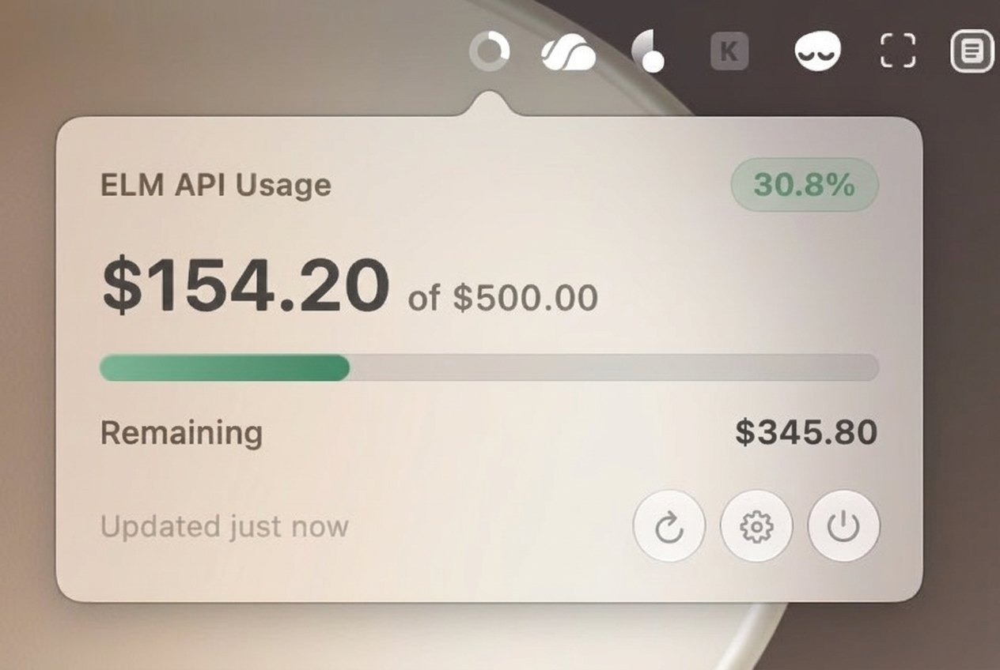

# ELM API Tracker

A minimal, native macOS menu bar utility for monitoring your [ELM](https://elm.edina.ac.uk) API spend (`GET https://elm.edina.ac.uk/api/v1/costs`).

<p align="center">
  
</p>

## Features

- **Monochrome circular progress ring** in the macOS menu bar (`isTemplate = true`, `LSUIElement = true`) with a solid used sector and dimmer remaining sector that adapts natively to light and dark menu bars.
- **Native macOS Liquid Glass popover** showing:
  - Usage vs. limit in USD with a threshold-tinted percentage badge
  - Smooth proportional capsule bar with dynamic color thresholds (`< 65%` sage, `65% – 85%` amber, `≥ 85%` muted crimson)
  - Remaining (or over-limit) balance
- **Smart polling**: refreshes every 5 minutes, on wake from sleep, and whenever you click the menu bar icon.
- **Keychain + environment + dotfile fallback**: checks macOS Keychain first, then `ELM_API_KEY` from the process environment, and falls back to reading static `ELM_API_KEY` exports directly from your `$HOME` shell profiles (`~/.zshrc`, `~/.zprofile`, etc.) without spawning a shell subprocess—so launching from Finder, Spotlight, or Launch at Login works immediately without folder permission prompts.
- **Launch at Login**: toggleable directly inside Settings when running as a `.app` bundle.

## Install

### Download a Prebuilt Release

Download the latest `.dmg` (or `.zip`) from [GitHub Releases](https://github.com/mvmalyi/elm-api-usage-tracker/releases), open it, and drag **ELM API Tracker** into **Applications**.

> Because releases are ad-hoc signed (not notarized with a paid Apple Developer ID), macOS may warn on first launch. Open **System Settings → Privacy & Security → Open Anyway**, or run:
> ```bash
> xattr -cr "/Applications/ELM API Tracker.app"
> ```

## Build from Source

### 1. Build the `.app` bundle

```bash
./scripts/build-app.sh
open "dist/ELM API Tracker.app"
```

To build, install into `/Applications/ELM API Tracker.app`, and launch immediately:

```bash
./scripts/build-app.sh --install --open
```

To build a universal `.dmg` + `.zip` package locally:

```bash
./scripts/build-app.sh --universal --version 1.0.0 --package
```

### 2. Run directly during development

```bash
ELM_API_KEY="your-key" swift run
```

### 3. Run tests

```bash
# With Command Line Tools only (no Xcode.app):
swift test --disable-xctest \
  -Xswiftc -load-plugin-library \
  -Xswiftc /Library/Developer/CommandLineTools/usr/lib/swift/host/plugins/testing/libTestingMacros.dylib

# With full Xcode installed:
swift test
```

## Publishing a Release

Pushing a version tag triggers [`.github/workflows/release.yml`](.github/workflows/release.yml) on `macos-26`, which runs tests, builds a universal (`arm64` + `x86_64`) `.dmg` and `.zip`, and publishes a GitHub Release automatically:

```bash
git tag v1.0.0
git push origin v1.0.0
```
